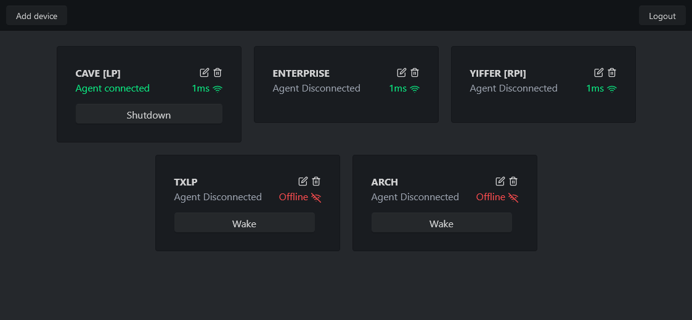

# Wake on LAN

A self-hosted dashboard to wake computers on your LAN, monitor their status, and suspend or shut them down through an optional agent. Built with Rust and SvelteKit.



## Getting started

Requires Docker and Docker Compose on a Linux host on the same LAN as your devices. Enable Wake-on-LAN on the computers you want to wake.

```sh
git clone https://github.com/thegamerx1/wakeonlan.git
cd wakeonlan
```

Edit [docker-compose.yml](docker-compose.yml):

- Set `APP_KEY` to a private token.
- Change `APP_PORT` if needed.

Start the app:

```sh
docker compose up -d --build
```

Open `http://<server-ip>:2938` and log in with your `APP_KEY`. Choose **Add device** and enter its name, MAC address, and IP address. The **Host** field requires an IP address; hostnames are not supported.

The container uses host networking. Device settings persist in the Compose `data` volume.

## Suspend and shutdown

Waking a computer needs no agent. To suspend or shut it down, run the agent on that computer (Linux with systemd or Windows).

Edit the device in the dashboard, choose **Regenerate** under **API KEY**, copy the key, and save with **Done**. These browser controls require HTTPS or localhost.

With Rust and Cargo installed, build and run the agent from the repository root:

```sh
cargo build --release -p agent
API_KEY='device-key' URL='ws://<server-ip>:2938/agent_ws' ./target/release/agent
```
